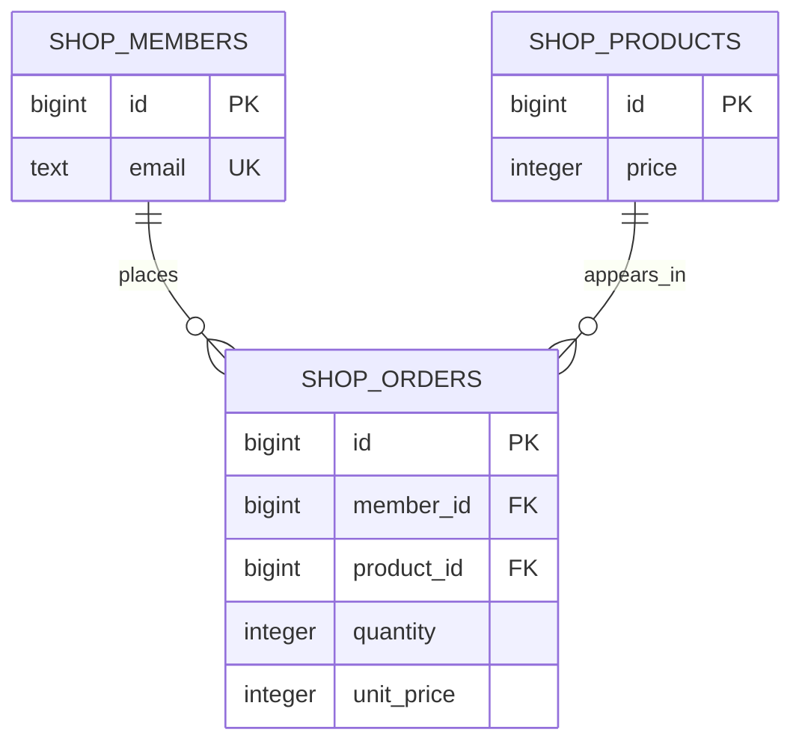
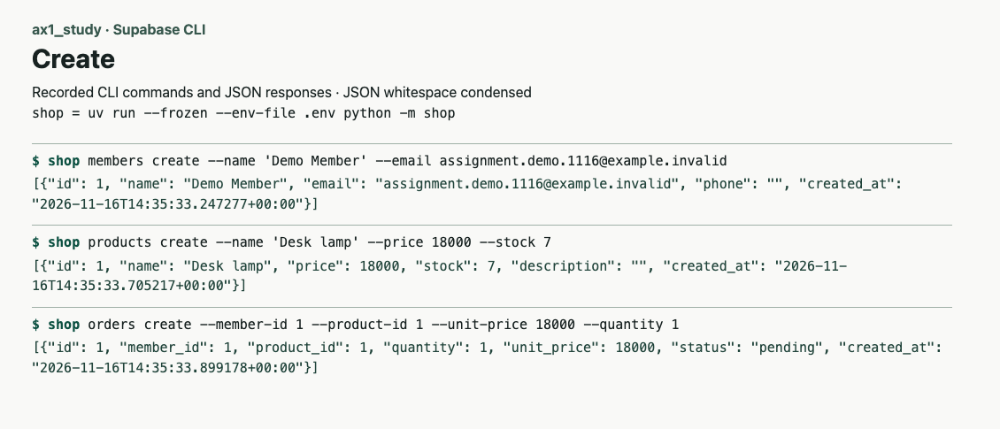
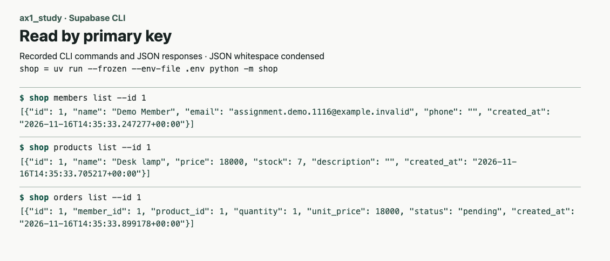
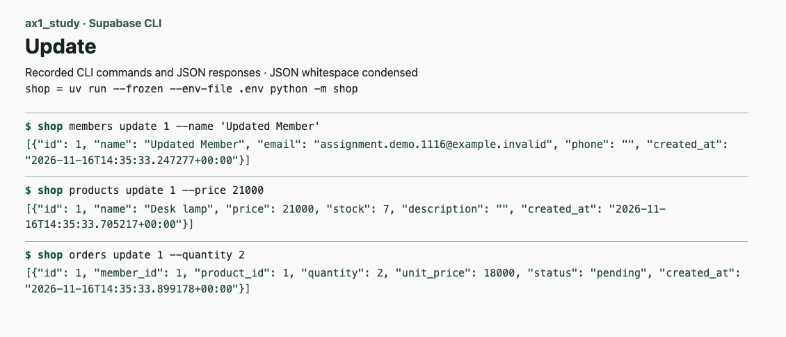
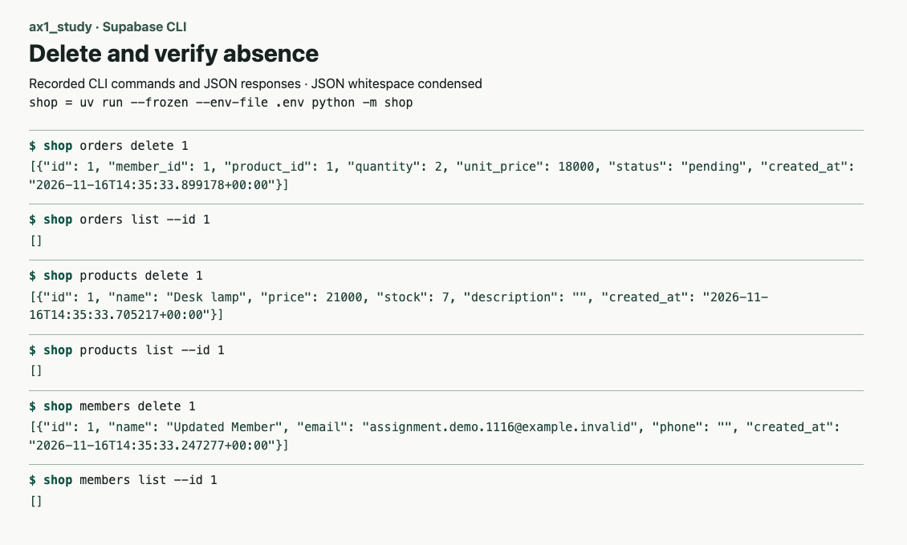

# Shopping CRUD with Supabase

A Python command-line application for managing members, products, and orders in a Supabase PostgreSQL database. The project was initialized with uv. The CLI uses Python's standard library to call the Supabase Data API and prints the returned rows as JSON.

**Submission repository:** [kssk3/supabase-project](https://github.com/kssk3/supabase-project)

## Run locally

1. Install uv and use Python 3.11 or later. Clone the repository and open its directory.
2. For a fresh Supabase project, run [sql/schema.sql](sql/schema.sql) once in the SQL Editor. The script creates the three tables in one transaction. It has already been applied to the assignment project, `ax1_study`.
3. Run the following commands and fill in the project URL and server-side secret key in your local `.env`. The Data API must be enabled with the public schema exposed. The key is for a trusted local operator. Keep it out of browser code, screenshots, and Git.

```sh
uv sync --frozen
cp .env.example .env
# After editing .env:
uv run --frozen --env-file .env python -m shop --help
```

The examples below use this shell function as a shortcut:

```sh
shop() { uv run --frozen --env-file .env python -m shop "$@"; }
```

## Tables and relationships



Every column is required (`NOT NULL` or a primary key). All three tables use database-generated IDs. Prices are integer Korean won (KRW).

| Table | Column | Type | Key, default, or rule |
| --- | --- | --- | --- |
| shop_members | id | bigint | PK, generated always as identity |
| shop_members | name | text | 1–100 characters after trimming |
| shop_members | email | text | Unique, basic email format |
| shop_members | phone | text | Defaults to empty text |
| shop_members | created_at | timestamptz | Defaults to now() |
| shop_products | id | bigint | PK, generated always as identity |
| shop_products | name | text | 1–100 characters after trimming |
| shop_products | price | integer | Current unit price, ≥ 0 |
| shop_products | stock | integer | ≥ 0, defaults to 0 |
| shop_products | description | text | Defaults to empty text |
| shop_products | created_at | timestamptz | Defaults to now() |
| shop_orders | id | bigint | PK, generated always as identity |
| shop_orders | member_id | bigint | FK → shop_members.id, ON DELETE RESTRICT |
| shop_orders | product_id | bigint | FK → shop_products.id, ON DELETE RESTRICT |
| shop_orders | quantity | integer | ≥ 1 |
| shop_orders | unit_price | integer | Unit price recorded at purchase, ≥ 0 |
| shop_orders | status | text | pending (default), paid, shipped, or cancelled |
| shop_orders | created_at | timestamptz | Defaults to now() |

Each order row represents one product purchased by one member. Either parent can appear in many orders. PostgreSQL blocks deleting a referenced member or product while an order still points to it. An order stores its own unit price, so changing the catalog price preserves the purchase price. The operator supplies the purchase price and manages stock separately. Row level security is enabled. The CLI uses a privileged server key, and anonymous and authenticated client roles have no direct table access.

## Try all twelve operations

Create a member and product first. Substitute their **returned IDs** for 1 and 2 below, then substitute the **returned order ID** for 3. Each table has its own ID sequence.

```sh
shop members create --name "Demo Member" --email demo@example.invalid
shop products create --name "Desk lamp" --price 18000 --stock 7
shop orders create --member-id 1 --product-id 2 --quantity 1 --unit-price 18000

shop members list --id 1
shop products list --id 2
shop orders list --id 3

shop members update 1 --name "Updated Member"
shop products update 2 --price 21000
shop orders update 3 --quantity 2

shop orders delete 3
shop products delete 2
shop members delete 1
```

Use `list` without `--id` to list rows. For example, `shop products list --limit 20 --offset 0` reads the first page in ascending ID order. A lookup after deletion returns `[]`. Updates and deletes on a missing ID return an error and exit with status 1.

## Live CRUD screenshots

These browser captures display the commands and JSON responses recorded from a live CLI run against **ax1_study** on **November 16, 2026 (KST)**. JSON whitespace was condensed for readability. Each table assigned ID 1 to its own demonstration record.

### Create

The member and product were created first. The order response contains both returned parent IDs.



### Read

A separate lookup by primary key retrieved each of the three stored rows.



### Update

The member name changed to Updated Member, the catalog price to 21000, and the order quantity to 2. The order retained its original unit price of 18000. A second read of each row verified that the changes persisted.



### Delete

The order was deleted first, followed by the product and member. Each delete returned the removed row, and each subsequent lookup returned an empty array.



## Run the tests

```sh
uv run --frozen python -m unittest discover -s tests -v
```

The automated suite checks request construction, validation, and error handling using a simulated transport. It runs without Supabase credentials. The screenshots above document a separate run against the hosted database.
